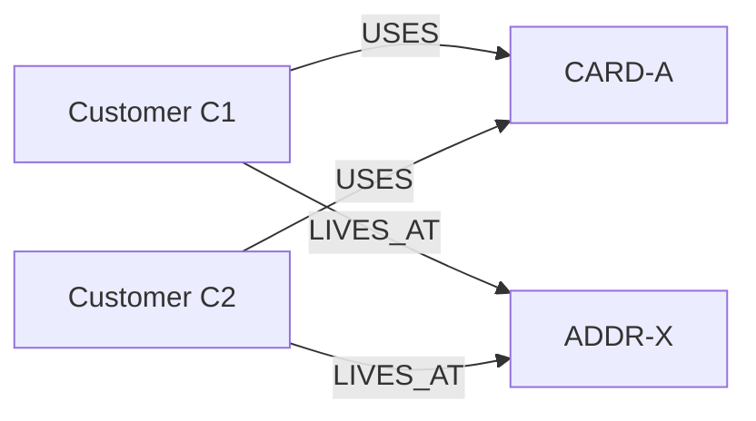

# Week 2 — Day 2: Relational and NoSQL Database Fundamentals

## BritMart Lab — Questions, Solutions, and Explanations

This workbook compares relational and NoSQL database models using BritMart's customers, orders, product catalogue, sessions, and fraud-investigation scenarios.

**Topics:** primary and foreign keys, SQL joins, document databases, key-value stores, column-family databases, graph databases, ACID, BASE, schemas, and database selection.

**How to use this file:** SQL examples are written for **MySQL**. Python examples use standard Python 3 and do not require MongoDB, Redis, or another database to be installed. The Python dictionaries are *illustrations* of NoSQL data structures, not actual database connections.

---

## Part 1 — Relational Databases and NoSQL

### Q1 — Build a Small Relational Model

**Task:** Create `customers` and `orders` tables. Give each a primary key and connect `orders.customer_id` to `customers.customer_id` using a foreign key.

```sql
CREATE DATABASE IF NOT EXISTS britmart_db_types;
USE britmart_db_types;

CREATE TABLE customers (
    customer_id INT PRIMARY KEY,
    customer_name VARCHAR(100) NOT NULL,
    city VARCHAR(50) NOT NULL
);

CREATE TABLE orders (
    order_id INT PRIMARY KEY,
    customer_id INT NOT NULL,
    amount_gbp DECIMAL(10,2) NOT NULL,
    status VARCHAR(20) NOT NULL,
    FOREIGN KEY (customer_id)
        REFERENCES customers(customer_id)
);
```

**Explanation:** A primary key uniquely identifies each row. The foreign key ensures that each order refers to an existing customer. `NOT NULL` makes a field required; `DECIMAL(10,2)` stores monetary amounts with two decimal places.

### Q2 — Insert and Join the Relational Data

**Task:** Insert three customers and four orders, then display the order ID, customer name, city, amount, and status.

```sql
INSERT INTO customers (customer_id, customer_name, city)
VALUES
    (1, 'Amelia Clarke', 'London'),
    (2, 'Oliver Bennett', 'Manchester'),
    (3, 'Aisha Khan', 'Leeds');

INSERT INTO orders (order_id, customer_id, amount_gbp, status)
VALUES
    (101, 1, 45.50, 'complete'),
    (102, 2, 18.00, 'cancelled'),
    (103, 1, 62.25, 'complete'),
    (104, 3, 30.00, 'complete');

SELECT
    o.order_id,
    c.customer_name,
    c.city,
    o.amount_gbp,
    o.status
FROM orders o
INNER JOIN customers c
    ON o.customer_id = c.customer_id
ORDER BY o.order_id;
```

**Expected result:**

| order_id | customer_name | city | amount_gbp | status |
|---|---|---|---:|---|
| 101 | Amelia Clarke | London | 45.50 | complete |
| 102 | Oliver Bennett | Manchester | 18.00 | cancelled |
| 103 | Amelia Clarke | London | 62.25 | complete |
| 104 | Aisha Khan | Leeds | 30.00 | complete |

**Explanation:** `INNER JOIN` matches orders with customers through `customer_id`. Amelia appears twice because she placed two orders. Run Q1 before Q2 in MySQL.

### Q3 — Represent the Same Customer as a Flexible Document

**Task:** Represent Amelia as a Python dictionary with email and nested preferences. Create a second customer without an email.

```python
customer_1 = {
    "customer_id": 1,
    "name": "Amelia Clarke",
    "city": "London",
    "email": "amelia@example.com",
    "preferences": {
        "newsletter": True,
        "language": "en"
    }
}

customer_2 = {
    "customer_id": 2,
    "name": "Oliver Bennett",
    "city": "Manchester",
    "preferences": {
        "newsletter": False,
        "language": "en"
    }
}

print(customer_1)
print(customer_2)
```

**Explanation:** The records have different fields: only Amelia has an `email`. This illustrates a flexible document structure. A Python dictionary is similar to a JSON object, but Python uses `True`/`False` while JSON uses `true`/`false`.

### Q4 — MCQ: Relational Database

**Question:** Which requirement strongly supports a relational design?

A. Many optional fields and no important relationships  
B. Access by a single key without joins  
C. Orders must reference valid customers and transaction consistency matters  
D. Traversing connections in a graph

**Answer: C.** Relational databases support foreign keys and strong transaction guarantees, which are valuable for orders and payments.

---

## Part 2 — Document, Key-Value, and Column-Family Designs

### Q5 — Choose the Better NoSQL Model

| Requirement | Suitable model | Why |
|---|---|---|
| A. Products have different optional attributes | **Document** | Each product can contain its relevant fields |
| B. Fast session lookup using a session ID | **Key-value** | Retrieve a value directly by its key |
| C. Large event data grouped by a known key, with many columns | **Column-family** | Suited to large-scale, key-oriented data |
| D. Customer profiles with nested addresses and preferences | **Document** | Nested objects fit naturally in documents |

**Explanation:** Choose based on the data's shape and how it will be accessed.

### Q6 — Build a Key-Value Example

**Task:** Store three sessions in a Python dictionary and retrieve `SESSION-1002`.

```python
sessions = {
    "SESSION-1001": {"customer_id": 1, "cart_count": 3},
    "SESSION-1002": {"customer_id": 2, "cart_count": 1},
    "SESSION-1003": {"customer_id": 3, "cart_count": 5}
}

print(sessions["SESSION-1002"])
```

**Expected output:**

```text
{'customer_id': 2, 'cart_count': 1}
```

**Explanation:** `SESSION-1002` is the lookup key. This resembles how a key-value store retrieves session data. The Python example itself does not connect to Redis.

### Q7 — Design Three Product Documents

**Task:** Create three JSON-like product documents with different attributes.

```python
products = [
    {
        "product_id": "P101",
        "name": "Office Chair",
        "colour": "Black",
        "material": "Mesh"
    },
    {
        "product_id": "P102",
        "name": "Laptop Stand",
        "colour": "Silver",
        "height_adjustable": True
    },
    {
        "product_id": "P103",
        "name": "Notebook Set",
        "page_count": 200,
        "paper_size": "A5"
    }
]

for product in products:
    print(product)
```

**Explanation:** A chair needs a `material`, a laptop stand has `height_adjustable`, and a notebook has `page_count`. Requiring every product to have every field would create many irrelevant or empty fields. Flexible documents can include only relevant attributes.

### Q8 — MCQ: Key-Value Database

**Question:** Which access pattern best fits a key-value database?

A. Find a session directly from its session ID  
B. Join five finance tables  
C. Traverse connected customer accounts  
D. Analyze every column in a historical table

**Answer: A.** Direct lookup by a unique key is the core key-value access pattern.

---

## Part 3 — Graph Data, ACID, and BASE

### Q9 — Model Connected Data

**Task:** Represent the relationships: C1 and C2 both use `CARD-A` and both live at `ADDR-X`.



**Text alternative:**

```text
Customer C1 --USES----> CARD-A <----USES-- Customer C2
Customer C1 --LIVES_AT-> ADDR-X <-LIVES_AT-- Customer C2
```

**Explanation:** Both customers share a card and an address. Graph models make such relationships easy to represent and investigate. Shared links may be worth investigating but do not prove fraud.

### Q10 — Identify the ACID Property

| Example | ACID property | Why |
|---|---|---|
| A. Order and payment must not be half-completed | **Atomicity** | All steps succeed or none do |
| B. A committed change survives a restart | **Durability** | Committed data is preserved |
| C. Concurrent transactions must not expose unsafe partial work | **Isolation** | Transactions are protected from harmful interference |
| D. A transaction leaves data in a valid state | **Consistency** | Defined database rules remain satisfied |

### Q11 — ACID or BASE?

| Requirement | Stronger fit | Reason |
|---|---|---|
| Bank-like payment update | **ACID** | Correctness of related updates is essential |
| Social activity count briefly out of date | **BASE** | Temporary inconsistency can be acceptable |
| Order and stock update must remain consistent | **ACID** | Related updates need reliable coordination |
| High availability more important than immediate consistency | **BASE** | Availability is prioritized while replicas converge |

**Explanation:** These are design tendencies, not absolute categories. Relational and NoSQL systems may support different combinations of transaction and consistency guarantees.

### Q12 — MCQ: BASE

**Question:** Which statement best describes a BASE-style design?

A. Every read must return the newest value immediately  
B. Temporary inconsistency may be accepted for availability and scale  
C. Every record must be in SQL tables  
D. Every operation must use a foreign key

**Answer: B.** BASE allows temporarily different copies of data, with the expectation that they eventually converge when updates and communication permit.

---

## Part 4 — Fixed vs. Flexible Schema and Database Selection

### Q13 — Fixed or Flexible Schema?

| Data | Starting schema | Reason |
|---|---|---|
| Payment transaction with required fields | **Fixed** | Required fields and correctness matter |
| Product catalogue with category-specific attributes | **Flexible** | Attributes differ between product types |
| Customer order line with required quantity and price | **Fixed** | Predictable fields and relationships matter |
| Event payload with changing optional fields | **Flexible** | Events may contain different attributes |

### Q14 — Choose Relational or NoSQL

| Requirement | Starting model | Reason |
|---|---|---|
| 1. Customer orders with strong foreign-key relationships | **Relational** | Keys and joins preserve important relationships |
| 2. Product descriptions with many optional attributes | **Document** | Flexible fields fit varied products |
| 3. User session lookup by session ID | **Key-value** | Efficient direct lookup |
| 4. Fraud investigation with many connected entities | **Graph** | Relationships can be traversed |

**Explanation:** Database selection depends on structure, relationships, consistency, and access patterns.

### Q15 — Review a Poor Design Choice

**Scenario:** BritMart stores payments as flexible documents with no required fields. Some records have `payment_id` but lack `order_id`, `amount_gbp`, and `status`.

**Risk 1 — Missing essential information:** A payment without an amount or status cannot be reliably processed or reported.

**Risk 2 — Weak order relationships:** Without a required `order_id` and an enforced relationship, a payment may not be traceable to a valid order.

**Better starting design:** Use a relational `payments` table with required columns, a primary key, and a foreign key referencing `orders`. Appropriate transactions and constraints help keep payment records reliable.

### Q16 — MCQ: Choosing a Database

**Question:** BritMart needs to store customers, orders, and payments with strong relationships and transaction correctness. Which is the strongest starting choice?

A. Graph database  
B. Key-value database  
C. Flexible document database with no required fields  
D. Relational database

**Answer: D.** A relational database supports the required keys, relationships, and transactions.

---

## Optional Practice

### Q17 — Design the Same Product Two Ways

**Task:** Model a Smart Desk (`P200`) and Notebook (`P201`) as relational rows and as documents. Decide which handles varying attributes more naturally.

**Relational example:** One shared product table with nullable category-specific columns.

```sql
CREATE TABLE product_catalogue (
    product_id VARCHAR(10) PRIMARY KEY,
    name VARCHAR(100) NOT NULL,
    price_gbp DECIMAL(10,2) NOT NULL,
    colour VARCHAR(30),
    motor_count INT,
    height_min_cm INT,
    height_max_cm INT,
    page_count INT,
    paper_size VARCHAR(10)
);

INSERT INTO product_catalogue
(product_id, name, price_gbp, colour, motor_count,
 height_min_cm, height_max_cm, page_count, paper_size)
VALUES
('P200', 'Smart Desk', 450.00, 'White', 2, 70, 120, NULL, NULL),
('P201', 'Notebook', 5.00, NULL, NULL, NULL, NULL, 200, 'A5');
```

**Document example (Python dictionaries):**

```python
products = [
    {
        "product_id": "P200",
        "name": "Smart Desk",
        "price_gbp": 450,
        "colour": "White",
        "motor_count": 2,
        "height_min_cm": 70,
        "height_max_cm": 120
    },
    {
        "product_id": "P201",
        "name": "Notebook",
        "price_gbp": 5,
        "page_count": 200,
        "paper_size": "A5"
    }
]
```

**Answer:** For this product catalogue, documents handle the different optional attributes more naturally. A single wide relational table would require many `NULL` fields. Relational databases can also model this in other ways, but that goes beyond this lab.

### Q18 — Find Shared Fraud Links

**Task:** Using Python lists, sets, and loops, find values shared by customers C1 and C2.

```python
relationships = [
    ("C1", "CARD-A"),
    ("C2", "CARD-A"),
    ("C1", "ADDR-X"),
    ("C2", "ADDR-X"),
    ("C3", "CARD-B")
]

c1_links = set()
c2_links = set()

for customer, linked_value in relationships:
    if customer == "C1":
        c1_links.add(linked_value)
    if customer == "C2":
        c2_links.add(linked_value)

shared = c1_links.intersection(c2_links)
print(sorted(shared))
```

**Expected output:**

```text
['ADDR-X', 'CARD-A']
```

**Explanation:** A `set` keeps unique values. `intersection()` returns values that appear in both sets. Sorting the result makes the printed order predictable. C1 and C2 share `CARD-A` and `ADDR-X`.

### Q19 — Database Choice Review

| BritMart system | Model | Schema style | Consistency need | Main access pattern |
|---|---|---|---|---|
| Checkout orders | **Relational** | Fixed | Strong | Transactions and joins |
| Product catalogue | **Document** | Flexible | Depends on use | Read product documents |
| Website sessions | **Key-value** | Flexible value | Depends on use | Lookup by session ID |
| Fraud investigation | **Graph** | Relationship-focused | Depends on use | Traverse connections |

**Explanation:** One business can use multiple database models for different needs. This is called **polyglot persistence**.

### Q20 — Explain the Trade-Off

**Statement:** “NoSQL is always faster, so all BritMart data should move to NoSQL.”

**Response:** No single database model is best for every workload. Relational databases are well suited to orders and payments because these need clear relationships, required fields, and strong transactions. Document databases suit products with different optional attributes; key-value databases suit fast session lookup; column-family databases suit large distributed datasets; and graph databases suit connected-data investigations. BritMart should choose databases according to data structure, access patterns, and consistency needs—not assume NoSQL is always faster.

---

## Final Check

- [x] Build a simple relational model using primary and foreign keys.
- [x] Insert data and retrieve it with a SQL join.
- [x] Represent flexible documents using Python dictionaries.
- [x] Recognize document, key-value, column-family, and graph use cases.
- [x] Explain ACID and BASE in simple terms.
- [x] Distinguish fixed and flexible schemas.
- [x] Choose database models based on business requirements.
- [x] Explain why no single database model is best for everything.

## Submission Notes

1. Save this file as `README.md` in your GitHub repository.
2. GitHub will render the headings, tables, SQL/Python code blocks, and Mermaid diagram automatically.
3. Copy the repository URL and submit it as directed by your course.

**Source:** BritMart *Week 2 — Day 2: Relational and NoSQL Database Fundamentals — Lab* workbook and its provided solutions. Explanations and formatting are adapted for clarity. SQL and Python examples are intended for learning; they have not been run against a live MySQL server.
